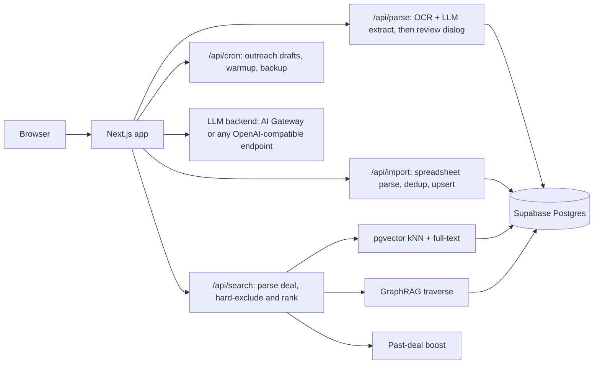

# Lender Index

An open-source database of lenders and funding sources, and what each one will finance, with
deal matching built in. Describe a deal in plain language and get back the lenders whose stated
criteria fit it, ranked, with the ones that cannot do it excluded and the reason shown.

## Who it is for

Brokers, financing advisors, and lenders' business-development teams in any asset class:
equipment, vehicles, real estate, working capital, or whatever categories you configure. Anyone
who keeps a "who lends on what" spreadsheet and wants it to answer one question fast: for this
borrower and this asset, which lenders will do the deal?

## What it does

- Intake goes through a person. Drop a business card, a QR-code vCard, a term sheet PDF, or a
  lender's own spreadsheet into the app; OCR and an LLM turn it into a lender record, and someone
  reviews it before it is saved.
- Duplicates are merged. New records are matched against the roster by normalized name, email
  domain and contact, so a lender that arrives from two workbooks ends up as one row carrying
  both sets of reps.
- Deals are described in plain language. "Caterpillar 320 for a contractor in Brazil, about
  $450k" is parsed into asset class, make and model, asset year, geography, deal size, usage,
  operation category and lender type.
- Stated criteria exclude, inferred ones only rank. A lender whose stated criteria contradict the
  deal is excluded and the reason is shown. Blank criteria count as unknown. Anything the system
  inferred can move a lender up or down but never removes it. Free-text notes such as "no
  Canada", "Texas and contiguous states" or "warehouses only in MN" are read into prefer and
  avoid signals that feed the same ranking.
- Search blends pgvector semantic search with Postgres full-text search, adds one GraphRAG hop
  over lender, contact and asset relationships, and boosts lenders that have closed similar deals.
- Closed-deal documents are extracted into records and shown on each lender's page.
- A daily job drafts follow-up emails for stale lender records. Each draft is approved from the
  principal inbox through a single-use link before anything is sent.
- Every field edit is logged with its old and new value, and every AI call and parse with its
  cost. A spreadsheet sync writes a rollback file first, and `pnpm restore:rollback` undoes it.

## Stack

Next.js 16 (App Router) · React 19 · TypeScript · Clerk (auth; admin / editor / viewer roles) ·
Supabase Postgres with pgvector and row-level security · Vercel AI SDK v6 with a swappable
backend (Vercel AI Gateway, or any OpenAI-compatible endpoint such as a local Ollama) ·
Tesseract.js OCR · shadcn/ui + Tailwind 4 · Vitest · Playwright · GitHub Actions.

## Architecture



The main tables are funding_sources, funding_source_contacts, closed_deal, graph_entity and
graph_edge, funding_source_edits, cost_log, parse_logs, activity_log and access_allowlist. The
LLM client is `src/lib/llm/client.ts`.

Every component runs unchanged on a self-hosted Supabase plus a local LLM, so AI compute can
move on-prem for privacy without a rewrite.

## Running it

1. Install dependencies and create your env file:

   ```bash
   pnpm install
   cp .env.local.example .env.local
   ```

2. Create a [Clerk](https://clerk.com) application and put its keys in `.env.local`.
3. Create a [Supabase](https://supabase.com) project, put its URL and keys in `.env.local`, and
   apply every file in `supabase/migrations/` in filename order (SQL editor or `supabase db push`).
4. Tell the database who may read. The row-level security SELECT policies call
   `_is_authorized_user()`, which reads the `access_allowlist` table. Writes are gated separately
   by `_is_editor()`, i.e. `public.users.role` of `editor` or `admin`. A pattern is either
   `@domain` or a full email address, lowercased:

   ```sql
   insert into public.access_allowlist (pattern) values ('@yourcompany.example');
   insert into public.access_allowlist (pattern) values ('pat@yourcompany.example');
   ```

   Set the matching `AUTH_ALLOWED_EMAIL_DOMAINS` / `AUTH_ALLOWED_EMAILS` in `.env.local`. The app
   checks the env values and the database checks the table; **both must be set**, and both
   empty means nobody is authorized. Domains match exactly (`yourcompany.example` does not admit
   `x@yourcompany.example.attacker.io`).
5. Optionally load demo data: `pnpm seed` inserts 26 clearly-labelled synthetic lenders. It
   refuses to run when `NEXT_PUBLIC_SUPABASE_URL` contains `PRODUCTION_SUPABASE_REF` or still
   contains the template `your-project-ref`.
6. Pick an AI backend. Locally: install [Ollama](https://ollama.com), pull the models named in
   `.env.local.example` (`LLM_MODEL`, `LLM_VISION_MODEL`, `EMBED_MODEL`) and leave
   `OPENAI_COMPAT_BASE_URL=http://localhost:11434/v1`. Hosted: set `LLM_BACKEND=gateway`,
   `AI_GATEWAY_API_KEY`, and `provider/model` strings in the model variables.
7. Start the app with `pnpm dev`, sign in, and promote your own account to admin:

   ```bash
   pnpm tsx scripts/promote-admin.ts owner@yourcompany.example --yes
   ```

Allowed users get the `editor` role on first sign-in; everyone else is a `viewer`.

## Configure asset categories

Everything specific to what you finance lives in one file,
`src/lib/config/vocabulary.ts` (types and derived helpers are in `src/lib/config/domain.ts`;
you do not need to edit it).

- `ASSET_CATEGORIES`: each category has an `id` (the value stored in
  `funding_sources.asset_classes`), a `label`, an optional `parent` (a generic parent such as
  `equipment` covers all of its children when matching), an optional lucide `icon` name,
  `keywords` (lowercase phrases in any language that tag a query or document with the class;
  pad with spaces, e.g. `' car '`, to require a whole word) and `makes` (brand / manufacturer
  names used for model extraction, graph seeding and the past-deal boost) and an optional
  `example` (one word used in LLM prompt examples; defaults to the first keyword).
- `RETIRED_ASSET_CATEGORIES`: categories that old rows may still carry but that are no longer
  offered.
- `ASSET_SUBTYPES`: display pick-list for the asset-subtypes column; never affects matching.
- `USAGE_CODES` and `OPERATION_CATEGORIES`: rank-only dimensions (they boost, never exclude).
- `BORROWER_INDUSTRIES`: industries the deal parser recognises.
- `DOMAIN_DESCRIPTION`: one phrase describing your business, used in every LLM prompt.
- `DEMO_QUERY`: the placeholder sentence in the search box.
- `ASSET_AGE`: the oldest plausible asset year, the age-filter labels and the age bands it offers.

**Stored ids must not change once data exists.** Labels, keywords, makes and icons can change
freely; renaming an `id` orphans every row that stores it (add a retired entry or migrate the
rows instead).

After editing, run `pnpm test`. `src/lib/config/vocabulary.check.test.ts` checks your file
(unique ids, parents exist, icons resolve, lowercase keywords, sane age bands). The rest of the
suite does not read your file: `vitest.config.ts` points `@/lib/config/vocabulary` at the shipped
defaults in `src/test/default-vocabulary.ts`, so a failing behaviour test is a real regression rather than a
difference in categories. Do not edit the fixture to match your deployment.

Lender types (Bank, Credit Union, Non Bank, Private Equity) are in
`src/lib/funding-sources/vocabularies.ts`. Geography is US-centric (US states, Domestic = US).

## Configuration

All variables go in `.env.local` (locally) or your host's environment settings.

| Variable | Required | Purpose |
|---|---|---|
| `NEXT_PUBLIC_APP_NAME` | no | Product name in the title bar and sign-in page. Default `Lender Index`. |
| `NEXT_PUBLIC_ORG_NAME` | no | Your firm's name; used in alt text and outreach drafts. Default `Your Company`. |
| `NEXT_PUBLIC_LOGO_URL` | no | Logo image URL. Empty shows the app name as a text wordmark. |
| `AUTH_ALLOWED_EMAIL_DOMAINS` | yes* | Comma-separated email domains allowed to write (exact match). |
| `AUTH_ALLOWED_EMAILS` | yes* | Comma-separated individual email addresses allowed to write. |
| `NEXT_PUBLIC_CLERK_PUBLISHABLE_KEY` | yes | Clerk publishable key. |
| `CLERK_SECRET_KEY` | yes | Clerk secret key. |
| `NEXT_PUBLIC_CLERK_SIGN_IN_URL` | yes | Sign-in route, `/sign-in`. |
| `NEXT_PUBLIC_CLERK_SIGN_UP_URL` | yes | Sign-up route, `/sign-up`. |
| `NEXT_PUBLIC_SUPABASE_URL` | yes | Supabase project URL, e.g. `https://your-project-ref.supabase.co`. |
| `NEXT_PUBLIC_SUPABASE_ANON_KEY` | yes | Supabase anon key. |
| `SUPABASE_SERVICE_ROLE_KEY` | yes | Supabase service-role key (server only; never expose it to the browser). |
| `PRODUCTION_SUPABASE_REF` | no | Project ref of your production database; `pnpm seed` refuses to run against it. |
| `AI_PRIVACY_MODE` | no | Document-parse path only. `strict` (default) keeps extraction on `OPENAI_COMPAT_BASE_URL`; `relaxed` allows the legacy NVIDIA NIM fallback, which sends document text to NVIDIA. |
| `LLM_BACKEND` | no | `gateway` (Vercel AI Gateway) or `openai-compat` (Ollama, vLLM, NIM, LM Studio). Defaults to `openai-compat` when `OPENAI_COMPAT_BASE_URL` is set, else `gateway`. |
| `LLM_MODEL` | yes | Text model id (`qwen2.5:7b-instruct` on Ollama, `provider/model` on the gateway). |
| `LLM_VISION_MODEL` | no | Vision model id. Empty means images go through OCR first. |
| `EMBED_MODEL` | yes | Embedding model id, e.g. `nomic-embed-text`. |
| `LLM_STRUCTURED_OUTPUTS` | no | `false` disables provider-native JSON schema mode for endpoints that return malformed JSON. Default `true`. |
| `EMBED_TIMEOUT_MS` | no | Ceiling on one embed call. Default `30000`. |
| `LOCAL_CHAT_TIMEOUT_MS` | no | Ceiling on one local extract call. Default `150000`. |
| `OPENAI_COMPAT_BASE_URL` | for openai-compat | OpenAI-compatible endpoint, e.g. `http://localhost:11434/v1`. |
| `OPENAI_COMPAT_API_KEY` | for openai-compat | API key for that endpoint (`not-needed` for Ollama). |
| `AI_GATEWAY_API_KEY` | for gateway | Vercel AI Gateway key. |
| `GRAPHRAG_ENABLED` | no | GraphRAG hop in search; on unless exactly `false`. |
| `SEARCH_RERANK_ENABLED` | no | LLM reranker; off unless exactly `true` (one extra LLM call per search). |
| `SEARCH_DEBUG_TOKEN` | no | Bearer token for `/api/search/debug` and `pnpm eval`. Unset keeps the route unusable. Treat it as a credential. |
| `PARSE_OCR_FIRST` | no | `true` runs Tesseract OCR ahead of the vision model. |
| `OCR_LANGS` | no | Tesseract language packs, `+`-joined. Default `eng+por+spa+fra+deu`. |
| `NVIDIA_API_KEY` | no | Legacy NIM-direct parse path; only reachable with `AI_PRIVACY_MODE=relaxed`. Not written to the cost log. |
| `NIM_TEXT_MODEL` | no | NIM text model for that legacy path. |
| `NIM_VISION_MODEL` | no | NIM vision model for that legacy path. |
| `CRON_SECRET` | for cron | Bearer token Vercel cron sends to `/api/cron/*`. |
| `PUBLIC_BASE_URL` | for outreach | Public URL that approval emails link back to. |
| `PRINCIPAL_NAME` | no | Name outreach drafts are signed with. Default: `NEXT_PUBLIC_ORG_NAME`. |
| `PRINCIPAL_INBOX_EMAIL` | for outreach | Mailbox that receives approval emails and sends dispatches, e.g. `deals@yourcompany.example`. |
| `MAX_DAILY` | no | Max outreach drafts per cron run. Default `30`. |
| `OUTREACH_DRY_RUN` | no | `true` logs drafts instead of sending. |
| `EMAIL_BACKEND` | no | `graph` (Microsoft Graph) or `dry-run`. |
| `GRAPH_DELEGATED_TOKEN` | for graph | Delegated Microsoft Graph token for the principal inbox. |
| `AZURE_TENANT_ID` | for graph | Entra tenant id, or `common`. Default `common`. |
| `AZURE_CLIENT_ID` | for graph | App registration client id. |
| `AZURE_CLIENT_SECRET` | for graph | App registration client secret. |
| `GRAPH_SCOPES` | no | Default `offline_access Mail.Send`; `offline_access` is what lets the token refresh. |
| `EVAL_BASE_URL` | no | Target for `pnpm eval`. Default `http://localhost:3000`. |

\* At least one of the two allowlist variables must be set, together with matching
`access_allowlist` rows in the database.

Keeping all inference local takes both `AI_PRIVACY_MODE=strict` and
`LLM_BACKEND=openai-compat`: the privacy mode governs document extraction only, while search,
reranking, embeddings, graph, outreach and closed-deal extraction pick their backend from
`LLM_BACKEND`.

## Spreadsheet import template

Import a roster from the Import page or with
`pnpm tsx scripts/import-roster-xlsx.ts <file.xlsx> [--dry-run]`. Columns are found by header
name (case- and spacing-insensitive), on any sheet, below any title rows. A file whose name
contains "international" or "intl" is tagged international. The import report lists every column it did
not read.

| Column | Maps to |
|---|---|
| *(first column)* | Lender type code: `B` Bank, `C` Credit Union, `NB` Non Bank, `PE` Private Equity (`L` is tagged lessor) |
| Account Name | Company name (required; rows without it are counted as skipped) |
| Main Contact (or First Name + Last Name) | Primary contact |
| Email | Primary contact email |
| Loan Minimum / Loan Maximum | Deal size; `M` = thousand, `MM` = million, and a header ending in `MM` makes bare numbers millions |
| (I) International (D) Domestic | `I`, `D` or both |
| Geographic Target | Fallback place list (US / International) |
| Specific Geographic | States or countries |
| Asset Classes | Category ids or labels from `domain.ts` |
| Asset Subtypes | Values from `ASSET_SUBTYPES` |
| Usage | Usage codes, labels or keywords from `USAGE_CODES` |
| Operation Category | Values or labels from `OPERATION_CATEGORIES` |
| Vintage Restriction | Free text, e.g. `15 Years`, `2010 or newer` |
| Lending Status | `No` marks the lender dormant |
| Bank Paid Fee | Free text |
| Notes | Internal notes (also read for prefer / avoid signals) |

`pnpm export:csv` writes the roster back out as `roster-export-domestic.csv` and
`roster-export-international.csv` (git-ignored).

## Tests and CI

```bash
pnpm typecheck   # tsc --noEmit, covers scripts and tests too
pnpm lint
pnpm test        # Vitest unit suite; no network or env needed
pnpm e2e         # Playwright API smokes against a running dev server
pnpm eval        # golden-set accuracy eval; needs a live backend
```

CI (`.github/workflows/ci.yml`) runs typecheck and the unit suite on every push and pull
request. The unit tests cover the matcher, the deal parser, the geography and currency
dictionaries, dedup, note-signal validation, the spreadsheet importer and the auth allowlist.

## Privacy posture

Lender records, notes and deal descriptions are business data. Two variables decide where AI
sees them:

- `LLM_BACKEND=openai-compat` with `OPENAI_COMPAT_BASE_URL` pointing at a model you host keeps
  search, embeddings, reranking, graph, outreach and closed-deal extraction on your hardware.
  `gateway` sends those calls to the Vercel AI Gateway and the provider behind it.
- `AI_PRIVACY_MODE=strict` (the default) keeps document extraction on the same local endpoint
  and refuses the legacy NVIDIA NIM fallback instead of taking it silently.

AI calls made through `src/lib/llm/client.ts` and local document extraction are written to
`cost_log`; the legacy NIM path is not.

See `NOTICE.md` for licensing status.
